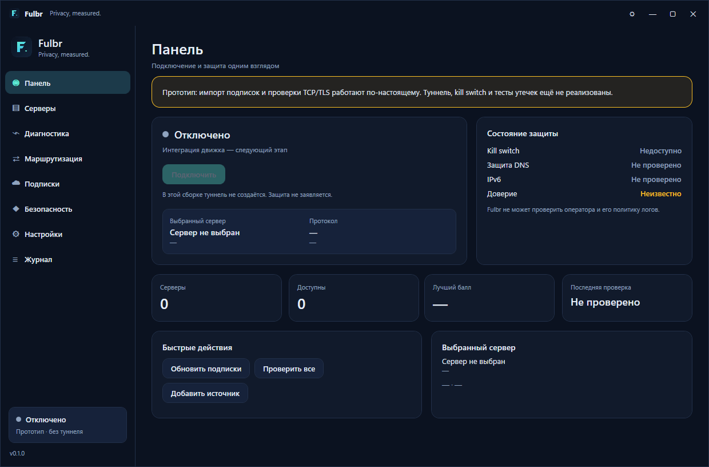
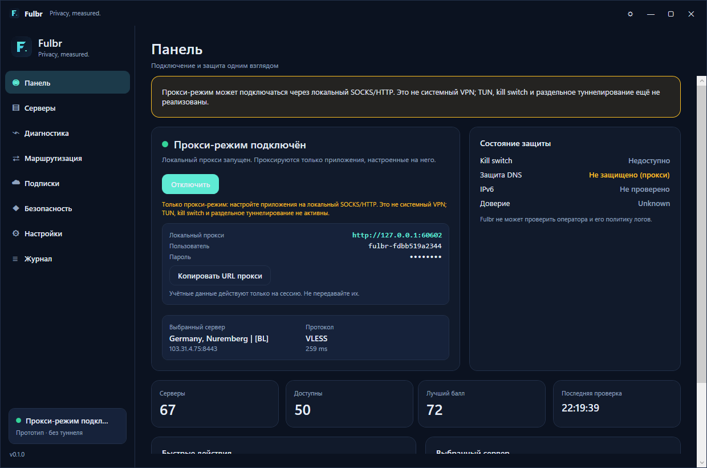
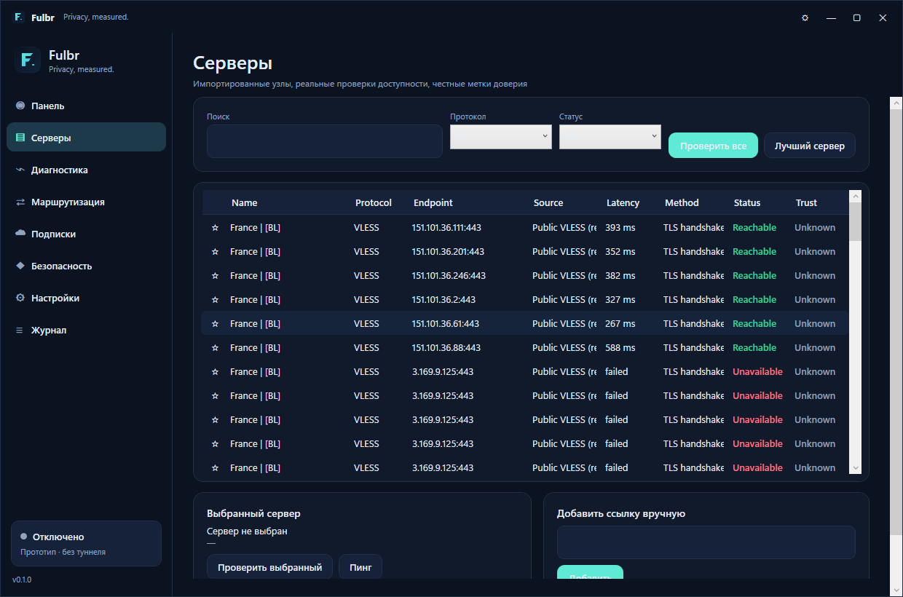

# Fulbr

[](https://github.com/artemraik4-bot/Fulbr/actions/workflows/ci.yml)
[](LICENSE)

**A privacy-focused Windows VPN and proxy client with honest diagnostics and smart split
tunneling.**

> **Project status: 0.2.0 proxy-mode prototype.** A real Windows desktop application is
> built and testable. It imports HTTPS subscriptions, parses 67 real servers from the
> reference source, performs real TCP/TLS reachability checks, ranks servers, and can
> connect through a pinned sing-box 1.14.4 engine using an authenticated local SOCKS/HTTP
> proxy. It does **not** create a system-wide TUN, install a Windows service, enforce a kill
> switch, or run leak tests. See [`IMPLEMENTATION_STATUS.md`](IMPLEMENTATION_STATUS.md).

---

## Current build (0.2.0)

| | |
|---|---|
| Dashboard |  |
| Proxy connected |  |
| Servers |  |

- 67 imported servers (47 VLESS, 18 VMess, 2 Trojan), 0 rejected.
- 67 real TCP/TLS probes: 50 reachable, 17 failed/unavailable.
- **Real proxy connection verified** through VLESS and VMess candidates; HTTP-through-proxy
  check passes before "Connected" is shown.
- 25/25 automated tests passing; build with 0 warnings.
- Startup ~880–924 ms; ~127 MB working set; 0% idle CPU (measured, see
  [`docs/performance/benchmarks.md`](docs/performance/benchmarks.md)).
- Installer: `artifacts/installer/Fulbr-Setup.exe` (68.53 MB, unsigned, per-user).
- SHA-256: `5BAA1180E64700C9E19A0B3966FA59B2E01FF13C368B3C727C8ED6A064E4E7E7`.

**Not implemented:** TUN/Wintun, system-wide VPN, Windows service, kill switch, split
tunneling, DNS/IPv6 leak tests, speed test, scheduled refresh, SQLite.

### Service/TUN development (0.3.0)

- `Fulbr.Service` is built: ACL'd named pipe, strict command allow-list, TUN engine
  supervision, Wintun bundled, TUN config validated by pinned `sing-box check`.
- IPC `ping`/`status`/invalid-link rejection are smoke-tested.
- **TUN adapter/routes/DNS/cleanup are verified on the host; payload DNS/HTTPS timed out and
  is not verified.** See
  [`docs/development/tun-host-test-2026-11-10.md`](docs/development/tun-host-test-2026-11-10.md).
- The persistent WFP kill switch is designed but not implemented; see
  [`docs/security/wfp-killswitch-design.md`](docs/security/wfp-killswitch-design.md).

---

## What Fulbr aims to be

- A real Windows 10/11 x64 VPN/proxy client, not a mockup.
- Support for VLESS (including Reality), VMess, Trojan, Shadowsocks, Hysteria2, TUIC, and
  WireGuard through a proven engine.
- Automatic subscription import from user-approved sources, with strict validation and
  provenance.
- Real server health checks with clearly labeled measurement methods.
- Deterministic split tunneling, including direct routing for selected Russian services.
- DNS/IPv6 leak prevention that is actually tested.
- A transparent kill switch with a documented recovery path.
- A clean, minimalist, bilingual (English/Russian) interface.
- No ads, no analytics by default, no hidden telemetry.
- Fully open source under GPL-3.0-or-later.

## What Fulbr will never do

- Claim a public server is private or anonymous just because it connects.
- Disable TLS verification silently.
- Execute scripts or binaries from a subscription.
- Disable Windows Defender or add antivirus exclusions automatically.
- Install drivers or services without explicit consent.
- Publish invented benchmarks or leak-test results.
- Copy proprietary UI or code from Happ or other clients.

---

## Architecture at a glance

```
Fulbr.exe (WPF, .NET 10, unelevated)
    │ named pipe (ACL)
Fulbr.Service.exe (privileged: Wintun, routes, DNS; WFP kill switch planned)
    │ child process
sing-box.exe (pinned GPL engine: TUN, outbounds, DNS, rule sets)
```

- **Engine:** sing-box v1.14.4, separate process, pinned and checksummed.
- **TUN:** Wintun 0.14.1, official signed DLL.
- **Kill switch:** planned service-owned WFP filters. The current TUN prototype relies on
  engine-scoped `strict_route`; it is **not** fail-closed across an engine crash.
- **Installer:** Inno Setup 6, `Fulbr-Setup.exe`.
- **License:** GPL-3.0-or-later, because of sing-box's GPL license.

Fulbr is not affiliated with, endorsed by, or sponsored by the sing-box, Xray, WireGuard,
Wintun, Happ, or Zapret projects. Third-party components keep their own licenses; see
[`docs/research/dependency-and-license-audit.md`](docs/research/dependency-and-license-audit.md).

---

## Documentation

| Document | Purpose |
|----------|---------|
| [`docs/research/overview.md`](docs/research/overview.md) | Research findings and sources |
| [`docs/research/windows-networking.md`](docs/research/windows-networking.md) | Wintun, routes, WFP, DNS, service boundary |
| [`docs/research/protocol-comparison.md`](docs/research/protocol-comparison.md) | Protocols and measurement semantics |
| [`docs/research/security-and-privacy.md`](docs/research/security-and-privacy.md) | Public-server and privacy risks |
| [`docs/research/technology-selection.md`](docs/research/technology-selection.md) | Weighted stack decision |
| [`docs/research/dependency-and-license-audit.md`](docs/research/dependency-and-license-audit.md) | Licenses and obligations |
| [`docs/architecture/overview.md`](docs/architecture/overview.md) | Modules, data model, routing, lifecycle |
| [`docs/architecture/networking-engine-evaluation.md`](docs/architecture/networking-engine-evaluation.md) | Engine choice and integration |
| [`docs/architecture/service-ipc.md`](docs/architecture/service-ipc.md) | Privileged service and IPC protocol |
| [`docs/security/wfp-killswitch-design.md`](docs/security/wfp-killswitch-design.md) | Persistent kill-switch design (not implemented) |
| [`docs/security/threat-model.md`](docs/security/threat-model.md) | Assets, actors, threats, mitigations |
| [`docs/security/public-server-risk-assessment.md`](docs/security/public-server-risk-assessment.md) | Trust classification for public configs |
| [`docs/security/split-tunneling-verification.md`](docs/security/split-tunneling-verification.md) | Test plan (not yet executed) |
| [`docs/security/dns-ipv6-leak-testing.md`](docs/security/dns-ipv6-leak-testing.md) | Leak test plan (not yet executed) |
| [`docs/security/connection-failure-policy.md`](docs/security/connection-failure-policy.md) | Kill switch and recovery policy |
| [`docs/development/environment.md`](docs/development/environment.md) | Machine inspection and setup plan |
| [`docs/development/tun-host-test-2026-11-10.md`](docs/development/tun-host-test-2026-11-10.md) | TUN host test result (partial) |
| [`ROADMAP.md`](ROADMAP.md) | Phased plan and acceptance criteria |
| [`IMPLEMENTATION_STATUS.md`](IMPLEMENTATION_STATUS.md) | What is actually done |
| [`NEXT_STEPS.md`](NEXT_STEPS.md) | Immediate next actions |

---

## Building

```powershell
powershell -NoProfile -ExecutionPolicy Bypass -File tools\fetch-vendor.ps1
powershell -NoProfile -ExecutionPolicy Bypass -File tools\build-release.ps1
```

`fetch-vendor.ps1` downloads the pinned sing-box 1.14.4 and Wintun 0.14.1 binaries and
verifies their SHA-256 against [`vendor/MANIFEST.json`](vendor/MANIFEST.json). They are not
committed to Git.

`build-release.ps1` restores locked packages, runs tests, publishes a self-contained
`win-x64` build to `artifacts/app`, and compiles `artifacts/installer/Fulbr-Setup.exe` with
Inno Setup 6. Build the privileged payload with `tools\build-service.ps1`.
Toolchain details and approval requirements are in
[`docs/development/environment.md`](docs/development/environment.md).

## Installing

The prototype installer is per-user and does not require admin. It creates a Start Menu
entry, an optional desktop shortcut, and an uninstaller. It does **not** install a service,
driver, or TUN adapter. User data under `%LOCALAPPDATA%\Fulbr` is preserved on uninstall.

Installation on the owner's PC is performed only after explicit approval.

---

## Contributing

Read [`CONTRIBUTING.md`](CONTRIBUTING.md), [`CODE_OF_CONDUCT.md`](CODE_OF_CONDUCT.md), and
[`SECURITY.md`](SECURITY.md) before opening an issue or pull request. Bug reports and
feature requests use the templates in `.github/ISSUE_TEMPLATE/`.

## License

GPL-3.0-or-later. See [`LICENSE`](LICENSE) and
[`THIRD-PARTY-NOTICES.md`](THIRD-PARTY-NOTICES.md).

## Security disclaimer

A VPN or proxy shifts trust; it does not eliminate it. Public configurations are operated
by unknown parties. Fulbr will report what it can verify and will say "Unknown" when it
cannot. Do not use a public proxy for banking, government, or identity services unless you
understand and accept the risk.
